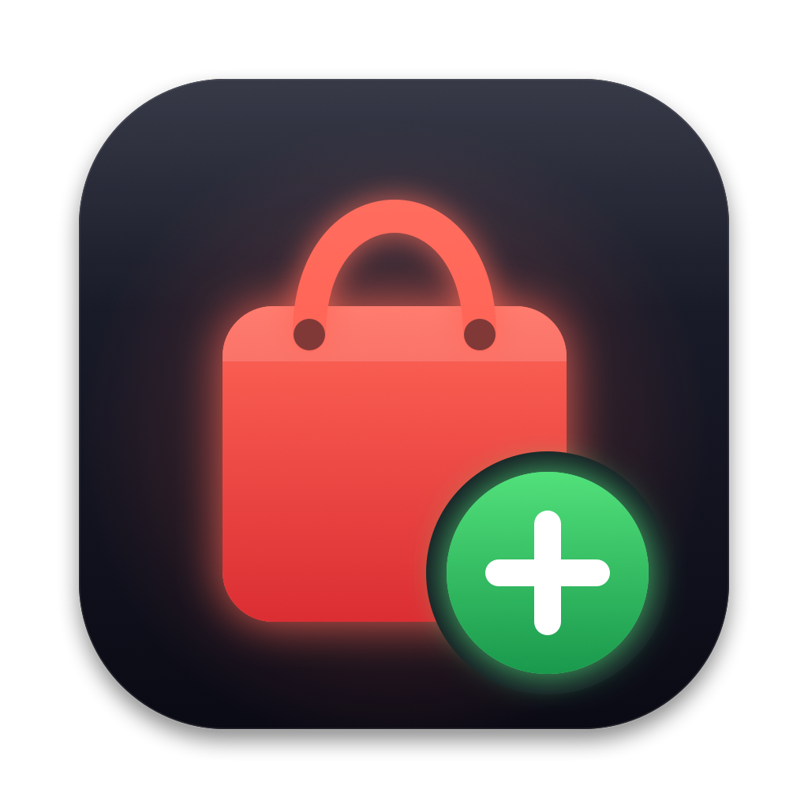
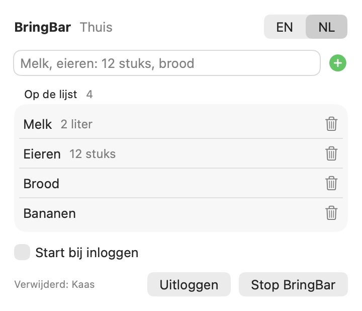
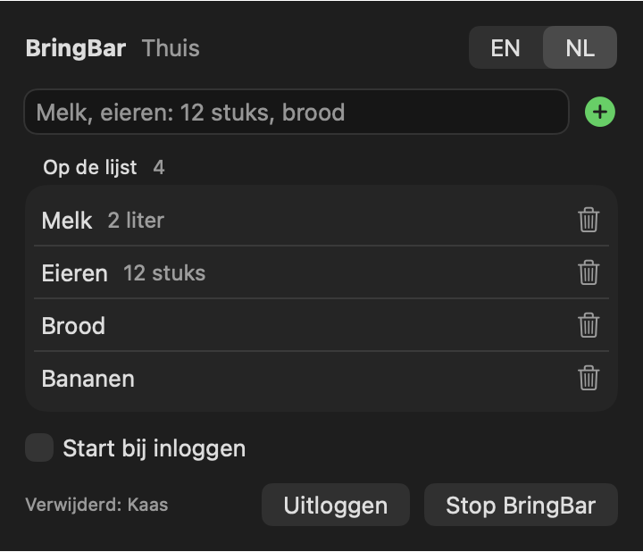

# BringBar



A small native macOS menu bar app for adding items to your **Bring!** shopping list fast. Press **⌥⌘B** anywhere, type `milk, eggs: 12, bread`, press Return, and the items show up on your phone right away.

> **Unofficial.** Not affiliated with or endorsed by Bring! Labs AG. BringBar talks to the same web API the Bring! web app uses. That API is not documented and may change. Use at your own risk.

<p align="center">
  
  
</p>

## Features

- **Quick add from the menu bar** or with the global shortcut **⌥⌘B**. It needs no Accessibility permission.
- **Several items at once:** separate them with commas. Details go after a colon: `eggs: 12, milk: 2 litres`.
- **Real catalog items:** "melk" becomes the Bring! catalog item *Milch*, so the app on your phone shows the right icon and section. Suggestions from the catalog appear while you type.
- **See and clean up the list:** what is on the list, with a trash can to remove an item.
- Supports several lists, and can launch at login.
- Lives in the menu bar, with no Dock icon. Native Swift and SwiftUI, Apple Silicon (arm64).
- The interface is available in **English and Dutch**, with an **EN | NL** switch. The first launch follows the language of macOS.

## Install

You only need the Xcode Command Line Tools (`xcode-select --install`), not Xcode.

```bash
git clone https://github.com/AlexBongers/bringbar-mac.git
cd bringbar-mac
./build.sh --install   # builds BringBar.app, copies it to /Applications and starts it
```

`./build.sh` without `--install` only builds `BringBar.app` next to the script.

## Sign in

Use the email address and password of your Bring! account. If you signed up with Google or Apple, first set a password in the Bring! app (Profile → Account).

Your password and session are stored in the **macOS Keychain**. When the session expires, BringBar signs in again on its own. The app is signed ad hoc, so macOS may ask once after a rebuild whether BringBar may use the keychain.

## How it works

| What | Endpoint |
| --- | --- |
| Sign in | `POST /rest/v2/bringauth` |
| Lists | `GET /rest/v2/bringusers/{user}/lists` |
| List items | `GET /rest/v2/bringlists/{list}` |
| Add | `PUT /rest/v2/bringlists/{list}/items` (`TO_PURCHASE`) |
| Remove | `PUT /rest/v2/bringlists/{list}` (`remove=`), or the batch call with `REMOVE` |
| List language | `GET /rest/bringusersettings/{user}` |
| Catalog translations | `https://web.getbring.com/locale/articles.<locale>.json` |

Items in classic lists have no item uuid, so removal by name uses the older form-based endpoint.

## Project layout

```
Sources/BringBar/   main.swift (status item, popover, hot key) · Views.swift · Store.swift · BringAPI.swift
Resources/          en.lproj / nl.lproj translations (the English text is the key)
Icon/make-icon.swift  draws the app icon in code: swift Icon/make-icon.swift
build.sh            compiles with swiftc and signs the app
```

SwiftUI's `@State` macro is not available in the Command Line Tools, so the views use `ObservableObject` instead.

Adding a language means adding one `Resources/<lang>.lproj/Localizable.strings` file.

## License

[MIT](LICENSE) © 2026 Alex Bongers
